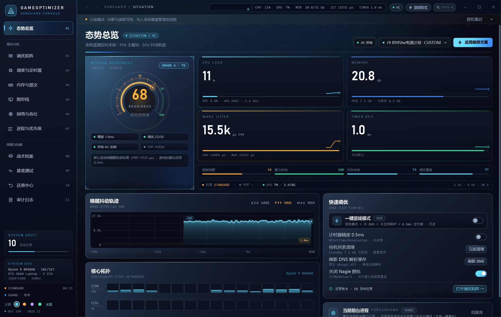
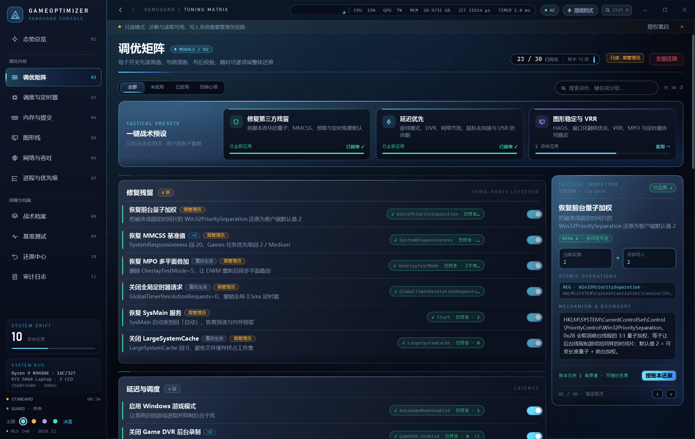
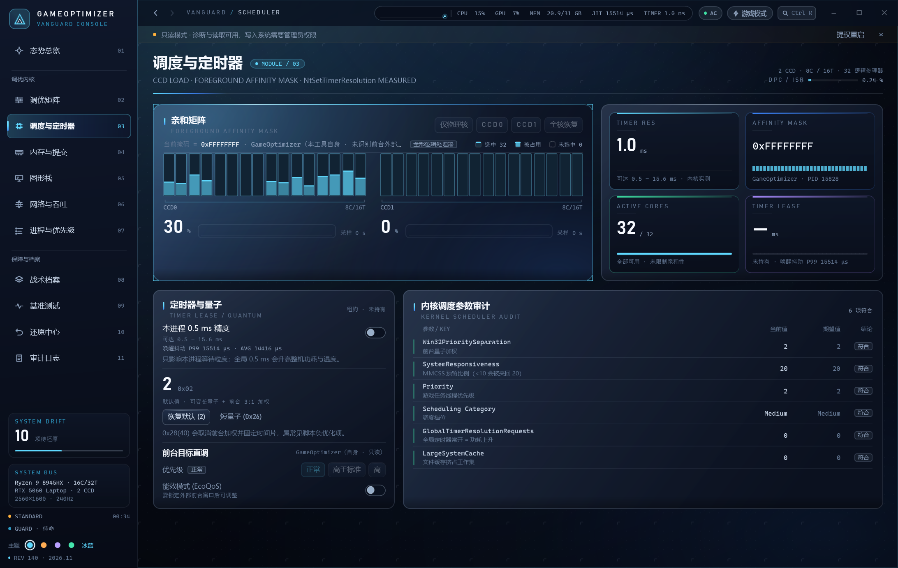
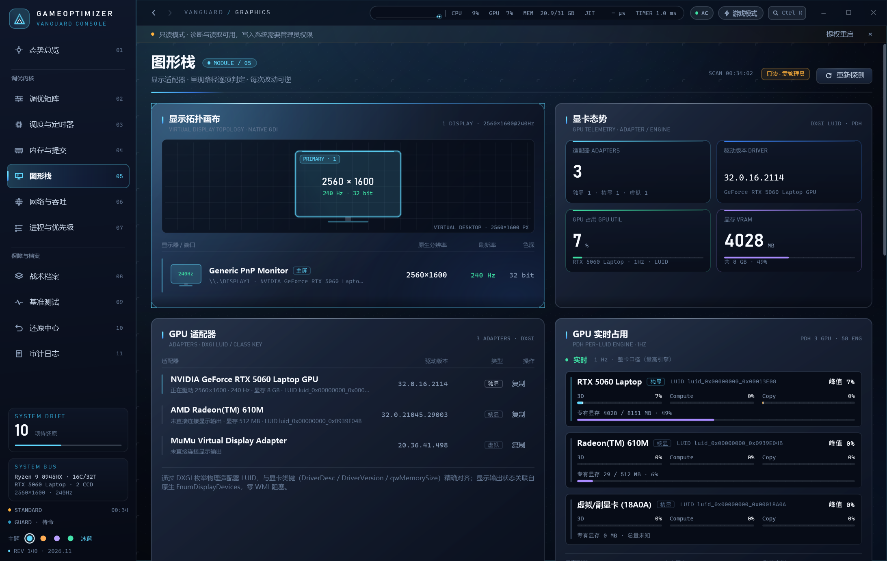

# GameOptimizer Pro

<p align="center">
  <a href="README.md">简体中文</a> · <strong>English</strong>
</p>

<p align="center">
  <strong>Zero-Dependency Single-File Windows 10/11 Game Performance Console · Write-Ahead Reversible Ledger · Native Win32 Telemetry</strong><br/>
  <em>VANGUARD CONSOLE · IRONCLAD KERNEL (Rev 140)</em>
</p>

<p align="center">
  <a href="https://github.com/rex25415/GameOptimizer-Pro/releases/latest">
    
  </a>
  <a href="https://github.com/rex25415/GameOptimizer-Pro/releases">
    
  </a>
  
  
  
  <a href="LICENSE">
    
  </a>
</p>

<p align="center">
  <a href="https://github.com/rex25415/GameOptimizer-Pro/releases/download/v1.40.0/GameOptimizer-Pro-v1.40.0-win-x64.exe">
    
  </a>
  &nbsp;
  <a href="https://github.com/rex25415/GameOptimizer-Pro/releases/latest">
    
  </a>
</p>

<p align="center">
  <sub><strong>Looking to run it right away? Click the green button above for the standalone <code>.exe</code> — no need to use the green <code>Code</code> source ZIP.</strong></sub>
</p>

<p align="center">
  <a href="#why-gameoptimizer-pro">Why</a> ·
  <a href="#visual-tour">Visual Tour</a> ·
  <a href="#built-in-modules">11 Modules</a> ·
  <a href="#download-and-quick-start">Download & Build</a> ·
  <a href="#measured-performance">Benchmarks</a> ·
  <a href="#faq">FAQ</a> ·
  <a href="CHANGELOG.md">Changelog</a>
</p>

<p align="center">
  
</p>

---

## Why GameOptimizer Pro

Most "one-click Windows gaming optimizer" scripts silently overwrite registry keys with harmful non-defaults (disabling MPO, locking short fixed quantums, disabling SysMain, forcing global 0.5 ms timers) with **no safe rollback**.

**GameOptimizer Pro** closes the full engineering loop: **Measure → Diagnose → Apply → Verify → Revert Anytime**:

- **Atomic Write-Ahead Ledger**: Before touching any setting, the original value (including "key/value did not exist") is flushed atomically (`FlushFileBuffers` + `File.Replace`) to `%LOCALAPPDATA%\GameOptimizer\ledger\ledger.json`. If journaling fails, the write aborts. Every write is read back and verified immediately, and every change can be reverted individually or all at once.
- **Third-Party Leftover Remediation**: Automatically detects 6 common counterproductive tweaks left behind by external optimizer scripts and offers one-click remediation.
- **Zero Dependencies · Pure C# 5 / WPF**: Compiles in ~0.7 seconds into a single `~1.24 MB` executable using only the built-in Windows `.NET Framework 4.8 csc.exe` — no Visual Studio, no .NET SDK, no third-party DLLs.
- **Zero Injection · Zero Drivers · Anti-Cheat Safe**: Pure user-mode documented Win32 APIs only. Never injects DLLs, never patches game binaries, never installs kernel drivers.

---

## Visual Tour

<table>
  <tr>
    <td width="50%">
      <strong>02 Tuning Matrix · Sticky Tactical Inspector</strong><br/>
      
    </td>
    <td width="50%">
      <strong>03 Scheduler · Interactive Silicon Die Topology</strong><br/>
      
    </td>
  </tr>
  <tr>
    <td width="50%">
      <strong>05 Graphics · Virtual Multi-Monitor Canvas & PDH GPU</strong><br/>
      
    </td>
    <td width="50%">
      <strong>09 Benchmark · 48-Bin Wake Histogram & Noise Verdict</strong><br/>
      
    </td>
  </tr>
</table>

---

## Built-In Modules

1. **01 Overview**: 4-axis real-time health scoring (Scheduling / CPU / Memory / Tuning coverage), `ArcGauge 3.0`, 5 Hz Fritsch-Carlson monotonic cubic wake-jitter waveform, per-core CCD heatmap, and quick controls.
2. **02 Tuning Matrix**: 30 documented Windows 10/11 tweaks (Registry, field-level `RegKv` for `DirectXUserGlobalSettings`, native `powrprof.dll` AC power indices, services), 3 tactical presets, live search, and a sticky **Tactical Inspector** showing `Current → Target` diff, atomic paths, and engineering rationale.
3. **03 Scheduler & Timer**: Auto-detects cores, threads, L3 clusters (AMD CCDs), and hybrid P/E efficiency classes (`GetLogicalProcessorInformationEx`); interactive affinity matrix (`CCD0` / `CCD1` / `Physical Only` / `All`), scoped 0.5 ms timer lease, and kernel scheduler audit.
4. **04 Memory & Commit**: `MemRibbon 3.0` physical page breakdown, commit/pagefile headroom, kernel paged/nonpaged pools, top working-set & native `K32GetProcessMemoryInfo` private bytes, Win11 EcoQoS throttling, and standby list purge.
5. **05 Graphics Stack**: Proportional virtual multi-monitor blueprint canvas (`EnumDisplayDevicesW`), DXGI multi-GPU LUID enumeration (auto-deduplicates MUX/Optimus dual LUIDs and flags virtual adapters), and 1 Hz per-LUID PDH GPU engine & VRAM telemetry.
6. **06 Network & Throughput**: Live 4-node route topology (`PC → NIC/TUN → LAN → WAN`), automatic Clash/Mihomo/WireGuard/Wintun detection, parallel LAN/WAN dual-path latency probing, 60s dual-channel oscilloscope, and active TCP PID aggregation.
7. **07 Processes & Priority**: Zero-handle double-buffered `NtQuerySystemInformation` process table, foreground auto-lock, per-process affinity / priority / Win11 EcoQoS control, and one-click profiling.
8. **08 Tactical Profiles**: Per-executable policy packs (`CCD / Priority / High-Performance GPU / 0.5 ms`) with automatic launch-attach & exit-revert daemon plus Steam / Epic / WeGame / Xbox / Desktop game discovery.
9. **09 Benchmark**: 8.0s wake-overshoot 48-bin adaptive histogram, memory bandwidth + pointer-chase latency, cross-thread event ping-pong, and historical A/B comparison with transparent `S/A/B/C` grading.
10. **10 Restore Center**: Write-ahead safety vault, forensic `Old → New` timeline, per-item revert, hold-to-revert-all, archive/keep, and snapshot export.
11. **11 Audit Log**: Append-only event stream of every apply, revert, daemon attach, and diagnostic fallback.

---

## Download and Quick Start

### 3-Step Quick Start
1. **Run Read-Only First**: Download the standalone `.exe` and launch it as a **standard user** to inspect hardware topology, 4-axis health diagnostics, and third-party leftover tweaks with zero writes.
2. **Elevate On Demand**: Click "Restart Elevated" inside the console only when applying HKLM / power policy / service tweaks — every original value is journaled atomically beforehand.
3. **Revert Anytime**: Open **10 Restore Center** to undo any item individually or hold **Revert All** to restore your exact pre-takeover system state.

### Option 1: Pre-Built Binaries

| Asset | Best For | Link |
|---|---|---|
| **`GameOptimizer-Pro-v1.40.0-win-x64.exe`** | Standalone single-file executable (`~1.24 MB`), double-click to run | [**Download EXE**](https://github.com/rex25415/GameOptimizer-Pro/releases/download/v1.40.0/GameOptimizer-Pro-v1.40.0-win-x64.exe) |
| **`GameOptimizer-Pro-v1.40.0-portable.zip`** | Portable bundle including `deploy.ps1` & `uninstall.ps1` | [**Download ZIP**](https://github.com/rex25415/GameOptimizer-Pro/releases/download/v1.40.0/GameOptimizer-Pro-v1.40.0-portable.zip) |
| **`SHA256SUMS.txt`** | SHA-256 verification checksums | [**Latest Release**](https://github.com/rex25415/GameOptimizer-Pro/releases/latest) |

```powershell
Get-FileHash .\GameOptimizer-Pro-v1.40.0-win-x64.exe -Algorithm SHA256
```

### Option 2: Zero-Dependency Build from Source (Windows 10 / 11)
No Visual Studio or .NET SDK needed:

```powershell
git clone https://github.com/rex25415/GameOptimizer-Pro.git
cd GameOptimizer-Pro
.\build.ps1                 # Compiles out\GameOptimizer.exe (~0.7s)
.\build.ps1 -Run            # Compile and launch
.\tools\deploy.ps1          # Install to %LOCALAPPDATA%\Programs\GameOptimizer + shortcuts
.\tools\uninstall.ps1       # Clean uninstall (preserves ledger by default; add -PurgeUserData to remove all)
```

---

## Measured Performance

Rev 140 (**IRONCLAD KERNEL**) moves hot paths onto zero-exception native Win32 APIs:

- **Native `advapi32.dll RegGetValueW`**: `P50 17.0 µs` hit / `15.5 µs` miss with **zero CLR `IOException`** on absent keys.
- **Zero `Process.GetProcessById` full-table scans**: Native single-handle affinity read **`2.7 µs`**, cached physical-core mask **`0.0 µs`**, liveness + PID-reuse guard **`2.3 µs`**, private bytes **`2.4 µs`** (vs `~13.8 ms` managed full-table scan).
- **Active TCP PID aggregation (`net.tcp.pid`)**: Persistent high-water buffer + short-TTL PID name cache **`P50 1.82 ms`** (10.9× faster) + parallel LAN/WAN dual-path probe.
- **Zero-alloc vector visuals**: `Waveform 41 B/frame`, `MemRibbon 0 B/frame`, `PerfSampler 0 B/tick`, zero `DropShadowEffect` offscreen shadow surfaces.
- **6 Built-In Verification Suites**: `--selftest` (`113/0`), `--uitest` (`84/0`), `--alloc-test` (`11/0`), `--stress-test` (`8/0`), `--backend-bench` (`fail=0`), `--daemon-test`.

---

## FAQ

<details>
<summary><strong>1. Is this safe with anti-cheat (VAC / Vanguard / EAC / ACE / BattlEye)?</strong></summary>

Yes. GameOptimizer Pro uses only documented user-mode Win32 APIs (Registry, power policies, process priority/affinity, read-only system telemetry). It **never injects DLLs, never reads/writes game memory, never modifies game files, and never installs kernel drivers**.

</details>

<details>
<summary><strong>2. Why does Windows SmartScreen warn on first launch?</strong></summary>

As an independent open-source project without a paid commercial EV code-signing certificate, Windows SmartScreen may warn on a newly published unsigned binary. You can verify the hash against `SHA256SUMS.txt` or compile your own identical `.exe` directly from source in ~0.7 seconds with `.\build.ps1` using only built-in Windows tools.

</details>

<details>
<summary><strong>3. Can every change really be reverted cleanly?</strong></summary>

Yes. Every write goes through the atomic write-ahead ledger (`%LOCALAPPDATA%\GameOptimizer\ledger\ledger.json`), recording the exact pre-change state (including "did not exist") before touching Windows. You can revert individual items or hold **Revert All** in **10 Restore Center** without touching unrelated user changes.

</details>

<details>
<summary><strong>4. Does it auto-detect AMD, Intel, NVIDIA, hybrid laptops, and multi-monitor setups?</strong></summary>

Yes — zero hardcoded hardware profiles. CPU clusters (AMD CCDs / Intel hybrid P+E cores), DXGI multi-GPU LUIDs (with MUX/Optimus deduplication), virtual display coordinates/refresh rates, AC/battery power state, NIC/TUN interfaces, and game libraries are all auto-detected dynamically at runtime.

</details>

---

## Transparency & Boundaries

- Starts as a **standard non-elevated user** by default (all telemetry and diagnostics work read-only); elevates on demand only when writing HKLM / power policies / services.
- Does **not** fabricate metrics or measure in-game FPS (real frame-time capture requires PresentMon/ETW); unavailable readings always display `—`.
- Zero telemetry, zero analytics, zero cloud calls — all data stays locally in `%LOCALAPPDATA%\GameOptimizer\`.

## License

Released under the [MIT License](LICENSE). Found a bug or have an idea? Open an [Issue](https://github.com/rex25415/GameOptimizer-Pro/issues/new/choose).
