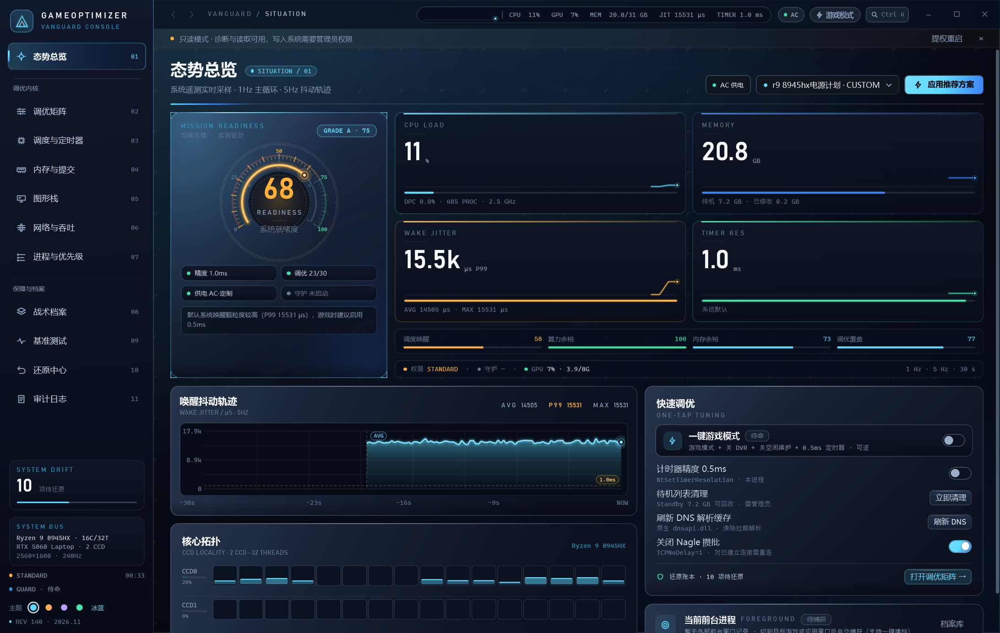
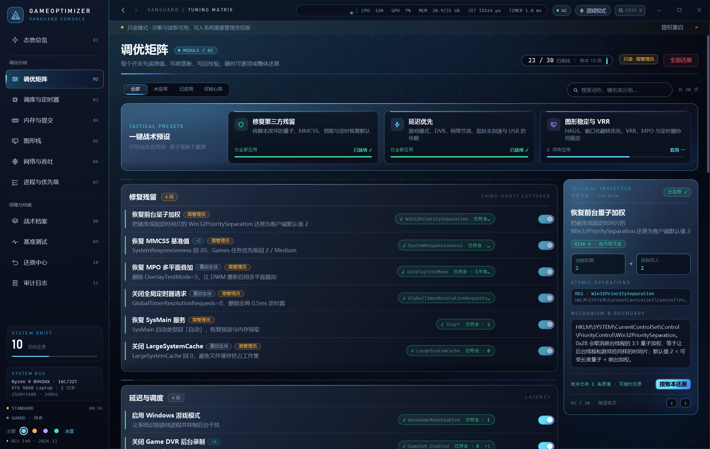
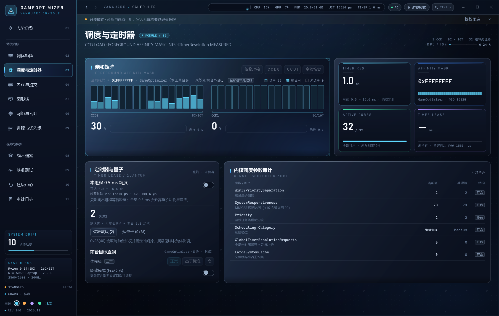
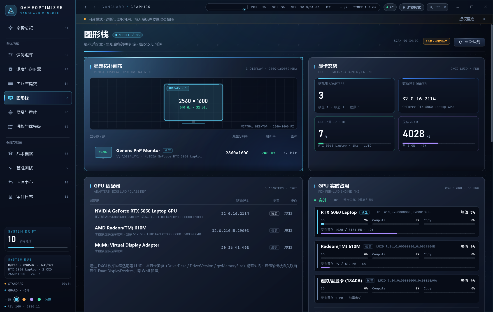

# GameOptimizer Pro

<p align="center">
  <strong>简体中文</strong> · <a href="README.en.md">English</a>
</p>

<p align="center">
  <strong>Windows 10 / 11 零依赖单文件游戏性能控制台 · 写前原子账本 · 逐项可还原 · 原生 Win32 实时遥测</strong><br/>
  <em>VANGUARD CONSOLE · IRONCLAD KERNEL (Rev 143)</em>
</p>

<p align="center">
  <a href="https://github.com/rex25415/GameOptimizer-Pro/releases/latest">
    
  </a>
  <a href="https://github.com/rex25415/GameOptimizer-Pro/releases">
    
  </a>
  
  
  
  <a href="LICENSE">
    
  </a>
</p>

<p align="center">
  <a href="https://github.com/rex25415/GameOptimizer-Pro/releases/latest/download/GameOptimizer-Pro-win-x64.exe">
    
  </a>
  &nbsp;
  <a href="https://github.com/rex25415/GameOptimizer-Pro/releases/latest">
    
  </a>
</p>

<p align="center">
  <sub><strong>永远只有一个最新单文件 <code>.exe</code>，不分版本、无需解压——双击即可运行，内置自选快捷方式安装、SHA-256 热更新与原生深色卸载（无需点右上角 <code>Code</code> 下载源码）</strong></sub>
</p>

<p align="center">
  <a href="#为什么做它">为什么做它</a> ·
  <a href="#界面预览">界面预览</a> ·
  <a href="#核心功能模块">11 大模块</a> ·
  <a href="#下载与上手">下载与上手</a> ·
  <a href="#后端实测性能">后端实测</a> ·
  <a href="#常见问题">常见问题</a> ·
  <a href="CHANGELOG.md">更新日志</a>
</p>

<p align="center">
  
</p>

---

## 为什么做它

市面上的很多「一键游戏优化脚本」往往把系统改成不可逆的非默认值（关闭 MPO、强制固定短时间片、禁用 SysMain、开启全局 0.5 ms 定时器……），实测多为负优化，且改完根本还原不回来。

**GameOptimizer Pro** 是一台把 **「测量 → 判断 → 施加 → 校验 → 随时还原」** 完整闭合的性能控制台：

- **写前原子账本（Write-Ahead Ledger）**：任何系统写入前，先读取并原子落盘原值（含「原本不存在」状态）至 `%LOCALAPPDATA%\GameOptimizer\ledger\ledger.json`；写盘失败则中止改动，写入后立刻回读校验，支持逐条还原、长按全部还原或归档确认状态。
- **自动识破第三方负优化残留**：启动主动扫描 6 类常见脚本负优化配置（错误量子加权、篡改 MMCSS、禁 MPO、全局定时器常开、禁 SysMain、开启 LargeSystemCache），支持总览页一键修复。
- **零外部依赖 · 纯代码 C# 5 / WPF**：无需安装 .NET SDK 或任何第三方运行库，Windows 10/11 原生 `csc.exe` 即可 1 秒内编出 `~1.24 MB` 单文件可执行程序。
- **零注入 · 零驱动 · 不碰反作弊**：纯用户态标准 Win32 API，不注入游戏进程、不修改游戏文件、不加载内核驱动。

---

## 界面预览

<table>
  <tr>
    <td width="50%">
      <strong>02 调优矩阵 · 随滚吸顶战术检视台</strong><br/>
      
    </td>
    <td width="50%">
      <strong>03 调度与定时器 · 交互式硅晶核心拓扑</strong><br/>
      
    </td>
  </tr>
  <tr>
    <td width="50%">
      <strong>05 图形栈 · 虚拟多屏蓝图画布与 PDH GPU 遥测</strong><br/>
      
    </td>
    <td width="50%">
      <strong>09 基准测试 · 48 箱唤醒超调直方图与噪声判定</strong><br/>
      
    </td>
  </tr>
</table>

---

## 核心功能模块

| # | 模块 | 核心能力 |
|---|---|---|
| `01` | **态势总览** | 四维系统健康评估（调度唤醒 / 算力余裕 / 内存余裕 / 调优覆盖）、`ArcGauge 3.0` 就绪表盘、5Hz 单调三次平滑抖动波形、硅晶核心热力与一键快控 |
| `02` | **调优矩阵** | 30 项系统调优（涵盖注册表、字段级 `RegKv` DirectX 全局开关、原生 `powrprof.dll` 电源子项与服务）、3 套战术预设、实时搜索与右侧随滚吸顶 **Tactical Inspector**（实测→目标 Diff / 原子路径 / 工程机理） |
| `03` | **调度与定时器** | 自动探测本机物理核/线程/L3 簇（CCD）/异构大小核，支持交互点选亲和矩阵（`CCD0` / `CCD1` / `仅物理核` / `全核`）、本进程 0.5 ms 定时租约与内核参数审计 |
| `04` | **内存与提交** | `MemRibbon 3.0` 物理页四级构成、提交与页面文件监控、内核分页/非分页池、Top 进程工作集与原生私有提交读数、Win11 EcoQoS 压制与待机列表清理 |
| `05` | **图形栈** | 原生 GDI 虚拟多屏蓝图画布（按真实坐标/分辨率/刷新率/色深等比绘制）、DXGI 多卡 LUID 识别（自动去重 MUX/Optimus 双 LUID 与虚拟卡）、1Hz PDH 逐引擎与显存占用 |
| `06` | **网络与吞吐** | 四节点实时路由拓扑（`PC → NIC/TUN → LAN → WAN`）、自动识别 Clash/Mihomo/WireGuard/Wintun 隧道、并行双路径延迟探测、60s 双通道吞吐示波与活跃 TCP 进程聚合 |
| `07` | **进程与优先级** | `NtQuerySystemInformation` 零句柄双缓冲进程表、前台目标自动锁定、单进程优先级 / 亲和核 / Win11 EcoQoS 精确控制与一键建档 |
| `08` | **战术档案** | 按游戏可执行文件固化 `CCD / 优先级 / 独显优先 / 0.5ms` 策略，动态守护在游戏启动瞬间自动挂载、退出后按账本复原；支持 Steam / Epic / WeGame / Xbox / 桌面多源扫描 |
| `09` | **基准测试** | 8.0s 唤醒超调 48 箱自适应直方图 + 内存带宽/指针追逐延迟 + 跨线程事件往返乒乓 + 同口径历史 A/B 对照与 `S/A/B/C` 评级 |
| `10` | **还原中心** | 写前安全金库统计、原值→新值法医时间线、逐条还原 / 长按全部还原 / 保留归档 / 快照导出 |
| `11` | **审计日志** | 只追加记录每次应用、还原、守护挂载与错误归因，支持关键字过滤与诊断报告导出 |

---

## 下载与上手

### 3 步极速上手
1. **下载双击即用**：永远只需下载唯一的 `GameOptimizer-Pro-win-x64.exe`，双击即可在**普通用户权限**下查看硬件拓扑、四维体检与负优化残留扫描（零写入）。
2. **自由勾选快捷方式（安装后自动释放下载文件）**：在顶部提示、左下角 `安装/卸载`、`10 还原中心` 或 `Ctrl+K` 中打开「应用安装与管理」窗口，按喜好勾选**桌面快捷方式**、**开始菜单入口**、**开机静默进托盘**；安装后自动无缝重启交接至安装目录，可立即删除下载文件夹里的原文件。
3. **内置热更新、还原与卸载**：默认零联网；随时可在同一窗口点击**「检查更新」**经 `SHA-256` 校验后一键热更新，或一键**复制脱敏硬件摘要**提交反馈；不想用时在软件内或 Windows「已安装的应用」直接卸载，退出自动清空目录零残留。

### 直接下载（唯一永久滚动最新版）

| 发行文件 | 说明 | 快捷入口 |
|---|---|---|
| **`GameOptimizer-Pro-win-x64.exe`** | 唯一单文件最新版（`~1.30 MB`），内置自选快捷方式安装、SHA-256 热更新与原生卸载 | [**直接下载最新版 EXE**](https://github.com/rex25415/GameOptimizer-Pro/releases/latest/download/GameOptimizer-Pro-win-x64.exe) |
| **`SHA256SUMS.txt`** | 发行包 SHA-256 哈希校验清单 | [**查看 Latest Release**](https://github.com/rex25415/GameOptimizer-Pro/releases/latest) |

> **如何核对文件哈希（PowerShell）**：
> ```powershell
> Get-FileHash .\GameOptimizer-Pro-win-x64.exe -Algorithm SHA256
> ```

### 从源码 0.7 秒自编译（可选）

全部源码完全公开透明；无需安装 Visual Studio 或 .NET SDK，仅用 Windows 10/11 自带的 `.NET Framework 4.8 csc.exe` 即可原地编译出完全一致的单文件 `.exe`：

```powershell
git clone https://github.com/rex25415/GameOptimizer-Pro.git
cd GameOptimizer-Pro
.\build.ps1                 # 编译 -> out\GameOptimizer.exe（约 0.7 秒）
.\build.ps1 -Run            # 编译并直接启动（安装/快捷方式/卸载均可在软件内随时管理）
```

---

## 后端实测性能

Rev 140（**IRONCLAD KERNEL**）将关键后端热路径全面收敛至零异常原生 Win32 API（`advapi32.dll RegGetValueW`、`OpenProcess` 单句柄亲和/判活/私有内存、持久化高水位非托管缓冲与共享进程表）：

| 基准项 | 实测结果（`--backend-bench` / `--alloc-test`） | 说明 |
|---|---|---|
| `reg.read` / `reg.read.miss` | `P50 17.0 µs` / `15.5 µs` | 原生 `RegGetValueW`，缺失键零 CLR `IOException` |
| `affinity.read.native` / `phys.cached` | `P50 2.7 µs` / `0.0 µs` | 彻底替代 `Process.GetProcessById`（`~13.8 ms` 全表扫描） |
| `proc.alive.native` / `proc.private.native` | `P50 2.3 µs` / `2.4 µs` | 原生单句柄判活防 PID 复用 + `K32GetProcessMemoryInfo` |
| `net.tcp.pid` | `P50 1.82 ms` | 持久化高水位 TCP 缓冲 + TTL PID 缓存 + 并行双路径探测 |
| `proc.table.refresh` / `cached` | `10.1 ms (76 B)` / `0.1 µs` | 单次 `NtQuerySystemInformation` 双缓冲快照 |
| `bus.raise` | `4.9 ns/op` | 内部脏标记事件总线 |
| 自绘光学图元稳态分配 | `Waveform 41 B` / `MemRibbon 0 B` / `PerfSampler 0 B/tick` | 全仓零 `DropShadowEffect` 离屏阴影合成负担 |

### 内置 6 套自动化自检

```powershell
.\out\GameOptimizer.exe --selftest selftest.txt          # 120 项后端原子事务、RegKv、并发、原生安装/更新与 Win32 校验
.\out\GameOptimizer.exe --uitest uitest.txt              # 85 项前端布局、交互、换肤、吸顶、引导与 11 页回归
.\out\GameOptimizer.exe --alloc-test                     # 11 项图元与采样器零分配预算探针
.\out\GameOptimizer.exe --stress-test                    # 8 项切页/换肤/面板泄漏与线程退出压测
.\out\GameOptimizer.exe --daemon-test                    # 守护引擎、会话落点与战报边界回归
.\out\GameOptimizer.exe --backend-bench bench.txt        # 19 项后端微基准对表
```

---

## 常见问题

<details>
<summary><strong>1. 会不会被游戏反作弊（VAC / Vanguard / EAC / ACE / BattlEye）误判？</strong></summary>

不会。GameOptimizer Pro 仅在用户态调用微软文档化的标准 Win32 API（注册表、电源策略、进程优先级/亲和性、系统遥测），**不注入任何 DLL、不读写游戏进程内存、不修改游戏文件、不加载任何内核驱动**。

</details>

<details>
<summary><strong>2. 首次双击弹出 Windows SmartScreen「已保护你的电脑」怎么办？</strong></summary>

本软件为个人开源项目，未购买昂贵的商业 EV 代码签名证书，因此全新发布的未签名 `.exe` 首次运行可能触发 SmartScreen 提示。你有两种完全透明的验证方式：
1. 点击「更多信息 → 仍要运行」，并用 `Get-FileHash` 对照 `SHA256SUMS.txt`；
2. 克隆源码后直接在 Windows 自带 PowerShell 里跑一行 `.\build.ps1`，**0.7 秒**从透明源码原地编出完全一致的单文件 `.exe`（无需装 Visual Studio 或任何 SDK）。

</details>

<details>
<summary><strong>3. 调优之后如果不满意或想恢复系统默认，真的能完全还原吗？</strong></summary>

可以。所有写操作均经过「写前原子账本」：写入前先将原值（包括键或值原本不存在的状态）原子落盘到 `%LOCALAPPDATA%\GameOptimizer\ledger\ledger.json`，落盘失败会直接中止修改。打开 `10 还原中心` 即可逐条或一键全部回放到修改前原值，且不会误伤你后续自己改过的其他系统设置。

</details>

<details>
<summary><strong>4. 支持 AMD / Intel / NVIDIA / 核显独显双卡笔记本和多显示器吗？</strong></summary>

全部支持，零机型硬编码。程序在启动时通过原生 Win32 / DXGI / GDI API 动态识别本机硬件：支持 AMD 多 CCD 簇、Intel 异构大小核、NVIDIA / AMD / Intel 单卡与笔记本双显卡（自动识别并去重 MUX/Optimus 双 LUID 与虚拟适配器）、任意多屏坐标与刷新率，以及台式机/笔记本 AC 供电状态。

</details>

---

## 快捷键、数据位置与边界声明

- **全局快捷键**：`Ctrl+K` 命令面板 · `Alt+← / Alt+→` 历史前进后退 · `Ctrl+1 ~ Ctrl+0` 直达前 10 页 · `Esc` 关闭浮层
- **本地数据目录**（所有数据仅存本机，无任何联网遥测上报）：
  - `%LOCALAPPDATA%\GameOptimizer\ledger\ledger.json`：写前原子账本（原值记录）
  - `%LOCALAPPDATA%\GameOptimizer\ledger\audit-YYYYMM.log`：追加式审计日志
  - `%LOCALAPPDATA%\GameOptimizer\profiles.json`：游戏战术档案
- **诚实边界声明**：
  - 本工具不测量游戏内 FPS（真实帧时间需要 PresentMon / ETW 级采集）；所有读数均为真实系统侧指标，读不到一律显示 `—`，绝不伪造数值。
  - 风险 C 项需长按确认；需重启生效项明确标注；详细演进记录与技术报告见 [CHANGELOG.md](CHANGELOG.md) 与 [REV140.md](REV140.md)。

---

## License

本项目采用 [MIT License](LICENSE) 开源。遇到问题或有建议欢迎提交 [Issue](https://github.com/rex25415/GameOptimizer-Pro/issues/new/choose)。
